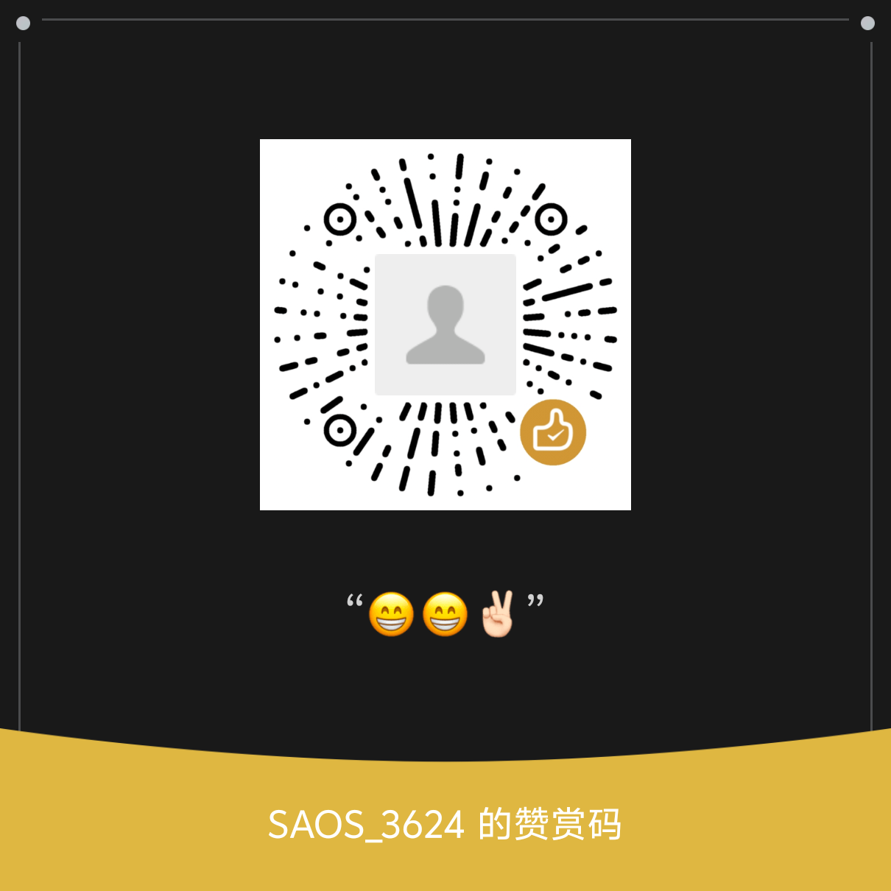
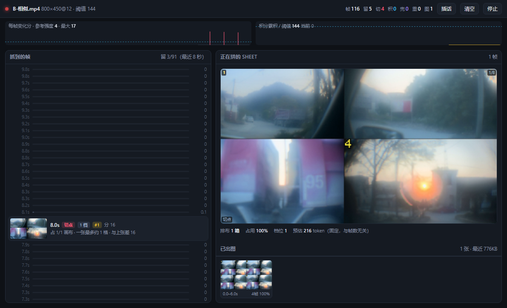
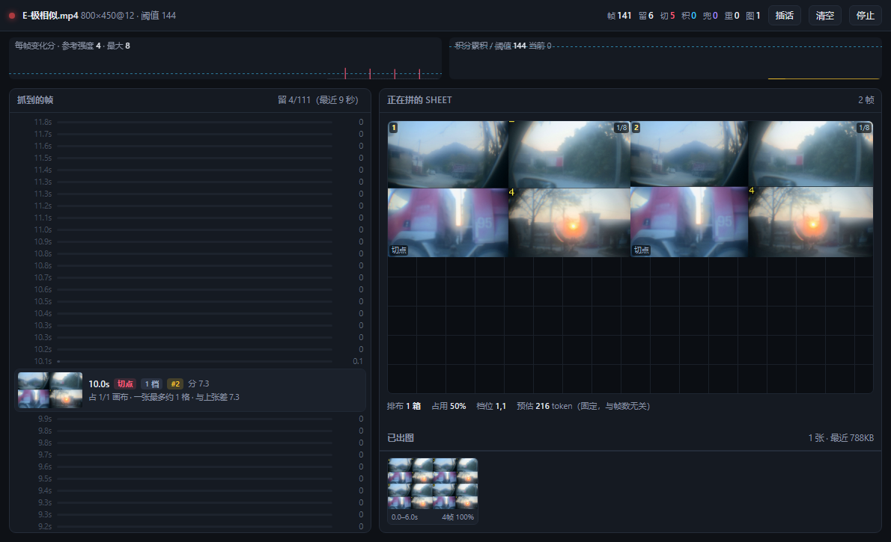
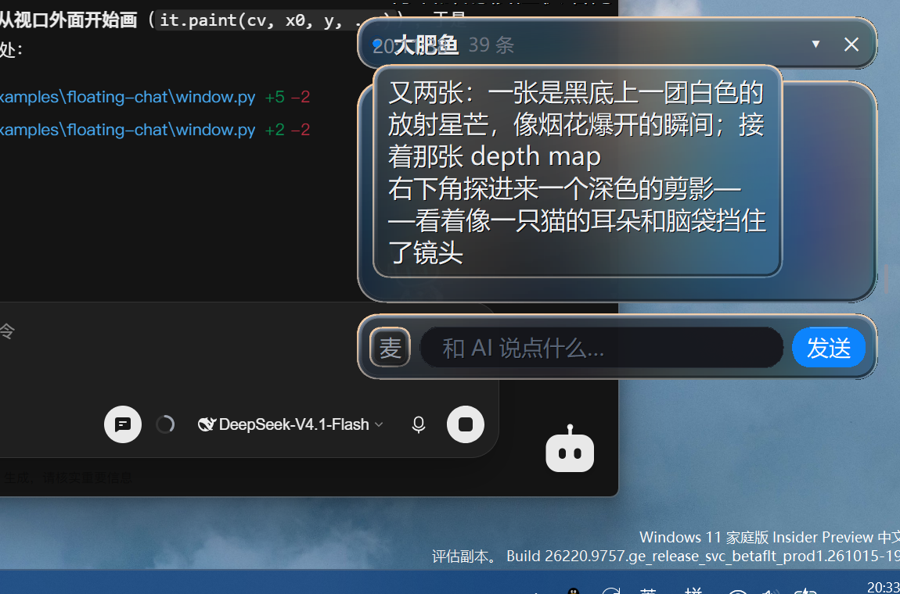

# Sense Now · 让 AI 实时看见你的屏幕

> **AI 不再"听你描述屏幕"，而是自己看 —— 而且只传"画面变了"的那几帧。**
> **V1.1 起还有第二条路：把视频建成可检索本地索引，按问题按需装载证据。**

一个给 [DSH](https://github.com/deepseek-ai) 用的视觉插件，两条独立工作流：

1. **实时陪看**（`sense_now`）—— 屏幕 / 摄像头 / 文件回放，按变化量筛帧拼图。
2. **视频索引问答**（`video_index`）—— 一次索引、多次查询；文本优先，视觉按需。

静止的屏幕几乎不花钱；一镜到底的视频按"运动量"给帧；硬切幻灯片每切一次留一帧。

> **项目来源**：Sense Now 基于 SAOS-3624 的
> [dsh-see-now](https://github.com/SAOS-3624/dsh-see-now) 开源项目继续开发，
> 保留原项目的 Apache-2.0 `LICENSE`、`NOTICE` 与作者归属。本仓库新增字幕优先长视频索引、
> 分块检索、按需音画证据及相关安全与预算控制。

---

## 授权说明 / License

**Apache License 2.0** —— 随便用。个人、公司内部、闭源产品、SaaS、二次分发都可以，
**不需要问我要授权，也不收费**。只要保留 [LICENSE](./LICENSE) 和 [NOTICE](./NOTICE) 这两份文件。

以下赞赏码来自原项目作者；如你希望支持上游维护，可以自愿使用，**不影响授权**：

<p align="center">
  
</p>

提交 PR 前读一下 [CONTRIBUTING.md](./CONTRIBUTING.md) —— 现在**不需要签 CLA** 了，
按 Apache-2.0 的规矩来就行。

---

## 看看它长什么样

调试窗（开发期用，不在发布包里）：左边是**抓到的每一帧**，留下的带缩略图和格号，没留下的只剩一根分数条；右边是**正在拼的那张图**，按真实像素位置摆，新帧落格会亮一下，重排时格子会滑动。



逐场景模式（`scene:true`）：每换一次画面单独出一张满幅图，右下角「已出图」每条都标着 `1 帧 100%`。



悬浮窗：AI 说的话在这里出现并被念出来（`say` 是唯一通道）。



---

## 它解决什么问题

想让 AI 陪你看屏幕，最直觉的做法是"定时截全屏喂过去"。两个死结：

| 做法 | 问题 |
|---|---|
| 每 2 秒截一张全屏 | 一分钟 30 张图，全是重复画面，token 直接烧穿 |
| 每隔 30 秒截一张 | 中间发生了什么全丢了，AI 只会说"看起来你在用电脑" |

Sense Now 换了个思路：**先判断这一帧值不值得看，再决定传不传**。

- 每个画面帧先打一个 **0–255 的"变化分"**（HSV 三通道加权差，在 64×36 网格上算，约 0.2ms）
- 只有"**画面突然换了一张**"或"**一直在动、攒够了量**"才留下来
- 留下来的几帧**拼进同一张图**，一张图的固定成本摊到 4~8 帧上

结果：同样一段 30 秒的操作，别人烧 30 张图，这里常常只要 2~3 张。

---

## 有多省

| 场景 | 表现 |
|---|---|
| 静止屏幕（看文档、发呆） | **几乎不出图**。20 秒给一张兜底帧，让你知道"确实没变" |
| 滚网页、切窗口 | 变化剧烈 → 留几帧 → 每 15 秒左右给你一张 |
| 一镜到底的视频 | 没有切点，靠"积分"攒够一个采样点才出帧 |
| 硬切幻灯片（每张停 2 秒） | **每切一次留一帧**，6 张照片 → 6 帧 |

成本口径：**800×450 一张 ≈ 233 token**（按宿主 DeepSeek-V4 的 patch 网格算：14px patch 向上对齐 → 42px 一格 → `rows×(cols+1)+2`）。
一张图里塞 4 帧还是 8 帧，**价格一样** —— 所以"多留一帧"几乎免费，"漏掉一帧"才贵。

> 插件源码里 `SIZES` 的旧注释写着 218 token，那是早期按"像素 ÷ 1650"估的，偏低。以 233 为准。

---

## 快速开始

### 在 DSH 里用

```bash
git clone https://github.com/canyueY/sense-now.git
cd sense-now
node scripts/install-dev.mjs      # 拷进本机 DSH 的 desktop profile
```

> `install-dev` 是**复制**不是软链（Node 解析裸包名要走真实路径，软链会找不到宿主的 `@deepseek-ai/dsh-tools`）。装完**重启 DSH** 生效。

然后让模型调：

```js
sense_now({ action: "watch" })          // 阻塞到你攒够一张图，然后把图交回来
sense_now({ action: "watch", say: "…" }) // 同时说一句话（只有 say 会进悬浮窗、会被念出来）
```

第一次调用约 1 秒返回当前屏幕；之后每次返回"这段时间里发生的事"。

### 工作流 B：视频索引问答（`video_index`）

与实时陪看**分开**：先建本地索引，再按问题检索证据（索引层**不编造**最终答案）。

```js
video_index({ action: "index", source: "file", path: "D:/talk.mp4" })
video_index({
  action: "index", source: "file", path: "D:/interview.mp4",
  capabilities: { diarization: "on", identityBinding: "on" },
  identityObservations: [/* face / speaker adapter observations */]
})
video_index({ action: "query", videoKey: "file:…:talk.mp4", question: "这段讲了什么" })
video_index({ action: "query", videoKey: "file:…:interview.mp4", question: "谁在说话", mode: "multimodal" })
video_index({ action: "query", videoKey: "…", question: "画面里按钮是什么颜色", mode: "visual" })
video_index({ action: "list" })
video_index({ action: "remove", videoKey: "…" })  // 只删这一个 key
```

| action | 作用 |
|---|---|
| `index` | 建/复用索引（同 fingerprint 默认复用；请求尚未就绪的 capability 或传入新 identity observations 时会重建；`rebuild:true` 强制重建）。可选 `capabilities`、`identityObservations`、`subtitlePath`（.srt/.vtt）；Bilibili 要 Storyboard 时需显式 `cacheMedia:true` |
| `query` | 返回检索上下文与引用；文本问题默认不附图 |
| `evidence` | 按 id / 时间范围取证据；`package:"minimal"\|"full"` |
| `zoom` | 已有 Storyboard 不足时局部取帧（受 `maxZoomRequests` 限制） |
| `status` / `list` / `remove` | 查看或精确删除一个 `videoKey` |
| `cleanup` | 清临时文件与过期查询缓存；可选 `maxAgeMs`（需 `confirmDelete` + 精确 `confirmVideoKeys`）删过期索引；可选 `purgeTrash`（需 `confirmDelete`，可配 `trashMaxAgeMs`）清理 `.__trash-*` 恢复副本（仅当 live manifest 有效） |
| `job_status` / `job_cancel` / `job_resume` | 长视频后台 job；`execution:"auto\|background"` 的 `index` 会立即返回 `jobId` |
| `capture_start` / `capture_stop` | 显式抓播 MVP（手动 `region`；可选 localhost `cdpEndpoint`）。无 URL 时 `audioScope:"system_mix"` |
| `refine` | 用 B 站 URL 对 capture/缺口做新 revision；或用 `confirmation.planHash` 确认二次分析计划（ask 模式无精确 hash 不写盘） |
| `execute_refinement` | 确认并执行 `query` 返回的 `on_demand` ASR 计划：必须回传精确 `planHash` + `confirmation:true`；计划已落盘；同 hash 幂等不重复 ASR；`asr.mode=off` 时零调用 |

`query` 在需要局部 ASR 时返回 `refinement: { kind:"on_demand_asr", status:"pending_confirmation", planHash, windows, … }`，Agent 应调用：

```js
video_index({
  action: "execute_refinement",
  videoKey,
  planHash: refinement.planHash,
  confirmation: true,
})
```

不要调用引擎内部函数；VAD 授权不代表 ASR 授权。

#### 字幕优先长视频（`analysisPolicy`）

未传 `analysisPolicy` 时行为与旧版一致（含短片 `maxFrames:120` storyboard）。显式传入后走**全片字幕优先**：先建字幕索引与 catalog，完整画面按需补充；系统建议不会自动改参数。

| 开关 | 默认 | 说明 |
|---|---|---|
| `subtitleFirst.enabled` | `true`（仅当传入 policy） | 低帧率字幕 ROI / 跳过批量全片抓帧 |
| `speechActivityAssist.enabled` | `false` | 与 ASR **独立**；关闭时不跑 VAD |
| `asr.mode` | `off` | `off` / `on_demand` / `fallback` / `full`；**不会**因 `HF_TOKEN` 自动打开 |
| `analysisProfile.primary` | `general` | 用户选择；`profileSuggestion` 只返回建议 |
| `secondPass` / `postAnalysisAudit.retryMode` | `off` / `ask` | `ask` 只出计划；`auto_once` 最多一次局部重试（白名单参数） |
| `captureUtteranceEndFrame.enabled` | `false` | 段尾稳定帧；profile 建议不得自动打开 |

示例（省资源 → 推荐 → 自动一次 → 深度）：

```js
// 最省：只要字幕轨，不要语音/二次分析
video_index({ action: "index", path: "D:/long.mp4",
  analysisPolicy: { asr: { mode: "off" }, speechActivityAssist: { enabled: false }, secondPass: { mode: "off" } } })

// 推荐：字幕优先 + 类型建议（不自动应用）
video_index({ action: "index", path: "D:/long.mp4", analysisPolicy: {} })

// 预授权一次局部复核
video_index({ action: "index", path: "D:/long.mp4",
  analysisPolicy: { postAnalysisAudit: { enabled: true, retryMode: "auto_once" }, secondPass: { mode: "auto_once" } } })

// 深度：用户显式 full ASR + 段尾帧（需自备 ASR adapter）
video_index({ action: "index", path: "D:/long.mp4",
  analysisPolicy: { asr: { mode: "full" }, captureUtteranceEndFrame: { enabled: true } } })
```

真实 OCR / ASR / VAD / AI auditor 需自行配置 adapter；未配置时 capability 为 `unavailable`/`skipped`，测试用协议级 fake，**不伪造 ready**。泛问（如「整个视频讲了什么」）会按时间覆盖选代表块，而不是只加载 Top 2～3。

#### 短视频 vs 超长视频 / B 站流式

- **短素材**：默认同步 `index`（与以前兼容）。
- **超长（约 >12 分钟）**：`execution:"auto"` 会先探测时长（B 站走 `resolveStreams`，本地文件走 `ffprobe`），超过阈值自动转后台；也可显式传 `durationMs` / `execution:"background"`，工具立即返回 `jobId`。用 `job_status` 看进度；工具超时取消**不会**误杀已提交的后台 job，除非 `job_cancel`。
- **URL 模式**（B 站普通投稿）：字幕/音频流是权威内容源；优先低清流与 Range 片段，**不默认下载整片 720p**。不支持直播、付费番剧、DRM、b23 短链。签名 URL / cookie **不落盘、不进模型上下文**。
- **Capture 模式**：必须显式 `capture_start`（手动 `region`）；会启动 CDP tick、可选 loopback、区域抓帧。无 URL 时 `audioScope:"system_mix"`。崩溃后**不能**无缝续抓，会记 `gap`；有 URL 时用 `refine` 补洞。loopback 可选依赖：`pip install soundcard` 后 `python scripts/loopback-recorder.py --check`；未安装时插件仍可加载，但 `audioCapture` 为 unavailable。装了 soundcard 后把 `DSH_LOOPBACK_PYTHON` 指向该环境的 Python（否则默认 `python` 可能没有依赖）。
- **CDP**：仅 `http://127.0.0.1:<port>`；内置 WebSocket transport（Node 22+ 全局 WebSocket）。Chrome 136+ 请用**独立** `--user-data-dir`，并加 `--remote-debugging-port` + `--remote-allow-origins=*`；只读采样 `video.currentTime/duration/paused/playbackRate`，不注入页面脚本。
- **Speaker merge**：默认关闭。需同时 `diarization:"on"` 与 `speakerMerge:{enabled:true}`；合并需要额外的 **`pyannote/embedding`（gated: auto）** 或本地目录 `DSH_PYANNOTE_EMBEDDING_MODEL`。该模型不可用时**不会拖垮 diarization**：说话人仍产出，`capabilities.speakerMerge` 记 `unavailable`，跨块 ID 保持 provisional。embeddings 默认不落盘（`persistEmbeddings:false`），永不进入 query/context。
- **检索**：长视频先扫 `chunks/catalog.json`；精确问加载命中+邻块，泛问走时间覆盖代表块（受硬预算）；citation 含 `chunkId` / `revision` / `timeSource`。
- **Embeddings**：默认不持久化；仅 `persistSpeakerEmbeddings:true` 才写本地 `private/`，且永不进入 query/context。
- **磁盘**：`cleanup` 清 job temp / 过期索引；活跃锁与唯一恢复副本默认保留。
- **实测 vs 估算**：`npm run bench:long-video` 只报告本机数字；抓播误差、实时倍率等**未在本仓库 CI 实测**，不要当 SLA。

索引目录默认：`${DSH_HOME}/sense-now/video-index/`（可用 `DSH_SENSE_VIDEO_INDEX` 覆盖；旧的 `DSH_SEE_VIDEO_INDEX` 仍兼容）。  
**依赖：** Storyboard 需要本机 FFmpeg；Bilibili 需要可选 `yt-dlp`（`DSH_YTDLP_PATH`）；ASR/OCR/人物为可选外部命令适配器，未配置时记 `unavailable`，**不会假转写**。抓播 loopback 为可选 Python 依赖（`scripts/loopback-recorder.py --check`），未安装时插件仍可加载。  
人物贴图与音色绑定是实验能力：状态机有单测，真实识别需自行接入 adapter。脸/声纹默认不进模型上下文，也不默认持久化生物特征。

#### 启用本地 ASR（faster-whisper，可选）

索引器内置可选的 `faster-whisper` runner（`scripts/asr-runner.py`），**默认关闭**；只有 `DSH_WHISPER_ENABLED=1` 或设置 `DSH_WHISPER_MODEL` 才启用。没有 ASR 时索引仍可建，只是 `utterances/chapters` 为空、状态 `degraded`。

```powershell
python -m pip install faster-whisper
$env:DSH_WHISPER_ENABLED = "1"
$env:DSH_WHISPER_PYTHON = "D:\...\.venv-pyannote\Scripts\python.exe"
$env:DSH_WHISPER_MODEL = "Systran/faster-whisper-small"   # 或本地模型目录
$env:DSH_WHISPER_DEVICE = "cpu"
$env:DSH_WHISPER_COMPUTE_TYPE = "int8"                     # CPU 推荐
```

探测与兼容：`python scripts/asr-runner.py --check` 只验证 import，不下载模型；首次转写会把模型下到 HF 缓存（可用 `HF_HOME` 改到可写目录）。转写时间戳是 chunk-local，JS 适配器会加 `offsetMs` 并写 `chunkId`。

#### 启用真实说话人分离（pyannote.audio）

索引器内置了可选的本地 `pyannote.audio` runner。**默认关闭**；只有显式设置 `DSH_PYANNOTE_ENABLED=1` 才会启用。  
`HF_TOKEN` / `HUGGINGFACE_HUB_TOKEN` / `DSH_PYANNOTE_MODEL` **只是模型访问凭据，不会单独打开功能**。  
设置 `DSH_PYANNOTE_ENABLED=0` 可强制关闭（即使已有 token 或本地模型）。

启用后，`diarization:"on"` 会执行真实音色分离，把 speaker、时间段写入 `audio-index.json`，回填 utterance，并在 `query.context.speakers` / minimal|full package 中返回**受限**说话人视图。首次真实推理可能下载模型；CPU 上可能较慢。`available()` 的 `--check` 只验证 Python/pyannote 能否导入，**不需要 token 或本地模型，也不会下载权重**。

runner 直接读取索引侧抽出的 **16 kHz 单声道 PCM WAV**，不经过 torchcodec，因此在**静态 ffmpeg**（没有 `avcodec-*.dll`）的 Windows 上也能工作；stdio 固定为 UTF-8，中文路径可用。

1. 使用 Python 3.10+ 安装依赖：`python -m pip install "pyannote.audio>=4,<5"`。
2. 在 Hugging Face 接受 `pyannote/speaker-diarization-community-1` 的使用条款并创建访问令牌（勿把真实 token 写进仓库或日志）。
3. 设置环境变量：

```powershell
$env:DSH_PYANNOTE_ENABLED = "1"           # 必须显式 opt-in
$env:HF_TOKEN = "hf_..."                  # 凭据，不是开关
$env:DSH_PYANNOTE_PYTHON = "python"       # 可选：虚拟环境 Python
$env:DSH_PYANNOTE_DEVICE = "auto"         # auto / cpu / cuda
```

离线：把 `DSH_PYANNOTE_MODEL` 指向本地模型目录；仍需 `DSH_PYANNOTE_ENABLED=1`。runner 默认 `PYANNOTE_METRICS_ENABLED=0`。

**Speaker merge（可选）**：跨块合并需要额外的 `pyannote/embedding`（gated: `auto`），或在本地下载后设置 `DSH_PYANNOTE_EMBEDDING_MODEL`。该模型不可用时 **diarization 仍正常**，`speakerMerge` 记 `unavailable`，跨块 speaker 保持 provisional，不会把整段索引拖垮。

```powershell
# 可选：本地 embedding 模型（需先接受 pyannote/embedding 条款）
python -c "from huggingface_hub import snapshot_download; snapshot_download('pyannote/embedding', local_dir=r'D:/models/pyannote-embedding')"
$env:DSH_PYANNOTE_EMBEDDING_MODEL = "D:/models/pyannote-embedding"
```

```powershell
# 先把约 33 MB 模型下到本地（之后可完全离线）
python -c "from huggingface_hub import snapshot_download; snapshot_download('pyannote/speaker-diarization-community-1', local_dir=r'D:/models/pyannote-community-1')"
$env:DSH_PYANNOTE_MODEL = "D:/models/pyannote-community-1"
```

```js
video_index({
  action: "index",
  source: "file",
  path: "D:/interview.mp4",
  capabilities: { diarization: "on", asr: "on", identityBinding: "on" },
  rebuild: true
})

video_index({
  action: "query",
  videoKey: "...",
  question: "分别有哪些人在说话，他们各自说了什么？",
  mode: "multimodal"
})
```

手工 smoke（不进 `npm test`）：见 `scripts/smoke-pyannote.md`。

画面人物与 speaker 的确认绑定仍需人脸证据或 `identityObservations`；**纯音频不得标 `identityBinding:ready`，也不会把单一音色标成「UP 主本人」**。

### 不进 DSH，当普通 Node 库用

包本身不依赖 DSH，`capture` / `pipeline` / `png` / `video-index` 都是独立导出的：

```js
import { spawnFrames } from 'sense-now/capture';
import { createPipeline } from 'sense-now/pipeline';

const p = createPipeline({ width: 800, height: 450, fps: 12, queueDepth: 0 });
const run = spawnFrames({
  source: { kind: 'screen' },           // 或 { kind:'file', path:'x.mp4' }
  width: 800, height: 450, fps: 12,
  onFrame: (f) => p.push(f),
});

setInterval(() => {
  const sheet = p.take();               // 一张 PNG + 每帧的时间戳/档位/来源
  if (sheet) require('fs').writeFileSync(`sheet-${sheet.at}.png`, sheet.png);
}, 200);
```

---

## 参数

| 参数 | 说明 |
|---|---|
| `action` | `watch`（默认，阻塞取图）/ `peek` / `start` / `stop` / `status` |
| `say` | **唯一能进悬浮窗、能被念出来的通道**。普通回复用户看不到 |
| `quality` | `low`(800×450) / `standard` / `high` / `ultra`。改它会重启采集（~0.6s），并立刻返回当前这一帧 |
| `pace` | 节奏：`calm` / `normal`（默认）/ `dense`。见下 |
| `scene` | `true` = 逐场景模式：一张图只装一个画面、铺满。见下 |
| `seconds` | `watch` 的阻塞上限（默认 300，封顶 860）。只是上限，攒够一张就提前返回 |
| `minFrames` | 少于这么多帧的图就别给我了（省 token） |
| `source` / `path` / `realtime` | 采集源：屏幕 / 摄像头 / 回放一个视频文件 |

### 三档节奏（`pace`）

| 档 | 换画面门槛 | 最多多久叫醒一次 | 适合 |
|---|---|---|---|
| `calm` | 20 分 | 30 秒 | 日常挂着，只想知道"大场面变了没" |
| **`normal`**（默认） | 12 分 | 15 秒 | 滚网页、切窗口不会每下都留帧 |
| `dense` | 7 分 | 8 秒 | 幻灯片、逐帧播报 —— 贵，别常开 |

> 觉得它太吵、太烧钱，就说一句「慢一点 / 省点钱」，模型会传 `pace:"calm"`。
> 觉得它漏了、迟钝，就说「不灵敏」，它会传 `dense`。

### 逐场景模式（`scene`）

打开后**每换一次画面单独给你一张满幅图**，并且每换一次就叫你一次 —— 用来做"每翻一页说一句这是什么"。

```js
sense_now({ scene: true, say: "好，接下来每换一个画面我就说一句" })
```

它是粘性的，一直生效到 `scene:false` 或停止。
单帧铺满靠的是 `strategy: 'single'`（档位固定压到 1），不然场景一密，格子会缩到 1/4、1/9，中间全是灰条。

---

## 它是怎么判断"变了"的

两条判据，缺一不可：

**① 切点** —— 这一帧的分数跳得又高又孤立

```
score ≥ cutAbs(12)                 // 绝对地板：变化够不够大
score > 2.5 × max(1, 前后帧)        // 尖峰：是不是"一下子"
距上一刀 ≥ 0.4 秒                   // 不应期
```

**② 积分** —— 分不高但一直有，攒够才录一帧

```
need = 4分 × 12fps × 3秒 = 144      // 固定的绝对阈值，不跟着画面一起涨
每帧累加自己的分，累够就录、清零
```

为什么两个都要：**尖峰是相对的**，在低分区也会成立。实测缓慢放大（持续运动）有帧 `s=13.6`、前后邻居只有 1.1/1.3，尖峰判据完全放行 —— 没有绝对地板，它就会被切成一块块。
反过来只有地板也不行：一镜到底的视频每帧 4 分，永远不会"跳"。

---

## 调试窗（不在插件里）

```bash
npm run debug:live                                   # 看屏幕
npm run debug:live -- --source=file --file=x.mp4 --realtime=1
npm run debug:live -- --source=file --file=x.mp4 --scene    # 看逐场景模式
```

Windows 上可以直接双击 `debug/调试窗.cmd`，跟着菜单走。

窗口里有三样东西：**帧流**（每一帧都有一条，留下的带缩略图和格号）、**正在拼的 sheet**（按真实像素位置摆，新帧落格有动效）、**两条曲线**（每帧变化分 + 积分累积/阈值）。

代码在 `debug/`，**不进 npm 包、不进插件**，只是从外面驱动同一条流水线。

---

## 实测（本机 i9-12900HX / RTX 4060 Laptop / 2560×1600）

采集开销（12fps → 800×450）：

| 源 | 首帧 | CPU |
|---|---|---|
| `ddagrab`（桌面复制 API） | 370ms | **0.28 核** |
| `gdigrab`（GDI 抓屏） | 310ms | 0.45 核 |
| OBS 虚拟摄像头 | 575ms | 0.13 核 |

变化分刻度（0–255，同一套代码）：

| 内容 | 分数 |
|---|---|
| 静止桌面 | **0.00**（屏幕采集近似无损） |
| 光标在静止画面上移动 | **0.7** |
| 两张色调接近的照片切换 | 16~18 |
| 滚网页 / 切窗口 | 30~42 |
| 两张完全不同的照片切换 | 46~63 |

所以 `cutAbs: 12` 这个默认值的位置是：**照片切换抓得住，光标和微小抖动碰不到**。

---

## 目录

```
src/
  capture.js         唯一 spawn ffmpeg 的地方（实时采集仍 -an）
  cuts.js / pipeline.js / tiers.js / pack.js / sheet.js
  runner.js / loop.js / index.js   实时陪看
  video-index-tool.js              video_index 工具
  video-index/                     离线索引子系统（schema/store/engine/adapters…）
examples/floating-chat/   悬浮窗（Tk，无边框圆角，置顶）
debug/                    调试窗（不在 npm 包里）
test/                     回归 + 索引子系统测试
docs/V1.1-COMPOSER-GROK-IMPLEMENTATION.md   V1.1 实施基线
```

基准（合成帧，可重复）：

```bash
npm run bench:video-index   # 旧单体 A/B synthetic benchmark（--duration-hours 会被忽略）
npm run bench:long-video    # 6h chunk catalog/retrieval benchmark（流式索引）
```


---

## 已知限制

- **只认"画面变了"，不认"语义变了"**。同一句话的两个排版版本算变化，两段内容不同但长得很像的页面可能算没变。
- **没有跨帧去重**（除了 `dupMin` 那道粗筛）。它不保证给你的每一帧都"有新信息"。
- **唤醒有节流**：再密也不会超过 `pace` 里的间隔 —— 语音播报是串行的，更快只会排队。
- **Windows 优先**。`ddagrab` / `gdigrab` 是 Windows 的引擎，Linux/macOS 需要自己补采集源。

---

## 协议

**Apache License 2.0** —— 商用、闭源、再分发、改完再卖都可以，保留 [LICENSE](./LICENSE) 与
[NOTICE](./NOTICE) 即可。

`examples/floating-chat/` 来自同作者的另一个项目 `dsh-watch-together`，两边现在是**同一个协议**，
不再有"这个目录 Apache、其余非商业"的分裂。

愿意打赏就扫上面那个码 —— 不打赏一样能用全部功能，**没有任何东西锁在付费后面**。

Copyright © 2026 SAOS-3624
